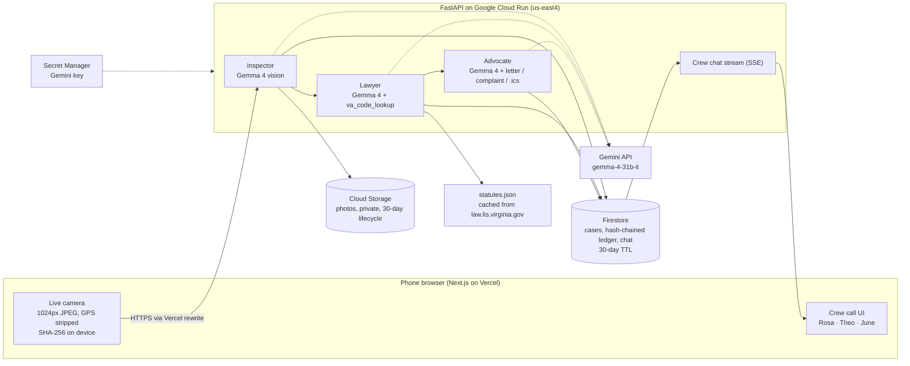

# HomeCrew

**Point your phone at your apartment. Three Gemma 4 agents inspect it, cite the Virginia law your landlord is breaking, and build your evidence file and repair paperwork, for free.**

Built at **GDG Build with AI x Hacktoberfest 2026**, Virginia Tech (Oct 24-25, 2026).
Tracks: GDG Best Overall AI for Housing · MLH **Best Use of Gemma 4**.

**Live demo:** https://homecrew-vt.vercel.app (open it on your phone; the camera needs HTTPS, which this has)

> Status: in progress during the hackathon. Sections marked _TODO_ get filled in before submission.

---

## The problem

- Virginia has had **705,120 eviction filings** since March 2020, and **10,712 in September 2026** alone. [1]
- In 2024, **74.6% of landlords had a lawyer. 0.8% of tenants did.** [1] Tenants with a lawyer are **7x more likely to win**. [2]
- Since **July 1, 2026** (SB 373, Va. Code **§ 55.1-1241**), a tenant sued for unpaid rent can raise serious repair problems like no heat, no water or rodents as a defense **without first paying rent into court**. [3] But the tenant has to show the condition existed and that they gave the landlord **written notice**.

Most renters don't know which law applies, what notice to send, or how to document the problem in a way a court will take seriously. HomeCrew does that part.

## What HomeCrew does

1. **Inspect:** open HomeCrew in your phone's browser, point the live camera at the problem, tap.
2. **Inspector agent** (Gemma 4 vision) marks the issue (mold, water damage, broken lock, exposed wiring, pests, missing smoke detector…) with a severity and a confidence score. Low-confidence findings get a "needs human check" badge.
3. **Lawyer agent** (Gemma 4 + Virginia Code lookup) maps each issue to the exact statute, quotes it, gives the deadline, and flags whether it's a § 55.1-1241 eviction defense. It can only cite sections its lookup tool returned.
4. **Advocate agent** (Gemma 4 + document tools) drafts the **§ 55.1-1234 21-day repair notice**, fills a code-enforcement complaint packet, and creates calendar reminders for each deadline.
5. **Evidence ledger:** every photo is SHA-256 hashed on your phone and timestamped, so you can later show it wasn't altered.
6. **You approve** before anything exports. HomeCrew never contacts your landlord or the town for you. It points you to free legal help (Southwest Virginia Legal Aid Society, 1-833-NoEvict).

_TODO: demo GIF + 2-minute video link_

## How Gemma 4 is used

Every agent runs on **Gemma 4 (`gemma-4-31b-it`) through the Gemini API**, with `gemma-4-26b-a4b-it` as a faster fallback and local **Ollama `gemma4:e4b`** as an offline fallback.

| Agent | Gemma 4 input | Output | Why AI is necessary |
|---|---|---|---|
| Inspector | camera frame (image) | JSON issues: type, location, severity, confidence | Recognizing mold vs. a shadow, or a stripped strike plate, needs vision; no rule-based tool can do it |
| Lawyer | Inspector findings + cached statute text (tool call) | statute section, plain-English summary, deadline, defense flag | Maps messy real-world defects onto legal categories, grounded only in retrieved statute text |
| Advocate | findings + statutes (tool calls) | repair notice letter, complaint packet, .ics | Writes a specific, plain-language letter per case instead of a generic template |

Prompts live in [`api/app/prompts/`](api/app/prompts/) _(TODO)_.

## Architecture



**How Google Cloud is used**

| Service | What it does in HomeCrew | Why |
|---|---|---|
| Cloud Run | Runs the FastAPI backend and all three agents | Scales to zero when idle (free), scales out for a demo; `max-instances=3` caps cost |
| Firestore | One document per case: findings, the hash-chained evidence ledger, the crew chat | Every change runs in a transaction, so concurrent instances can't overwrite each other. A TTL policy deletes cases after 30 days |
| Cloud Storage | The evidence photos | Private bucket (public access prevention on), lifecycle rule deletes photos after 30 days |
| Secret Manager | The Gemini API key | The key never sits in code or plain env vars; only the service account can read it |
| IAM | Dedicated `homecrew-api` service account | Least privilege: Firestore user + object admin on one bucket, nothing else |
| Cloud Build | Builds the container from `api/Dockerfile` on deploy | No local Docker needed |

The web app runs on Vercel and proxies `/api/*` to Cloud Run, so the phone talks to one HTTPS origin (needed for the camera) and there's no CORS.

## Responsible AI

- **Grounding:** the Lawyer may only cite Virginia Code sections returned by its lookup tool. Statute text is pre-cached from the official Virginia Legislative Information System API. Every legal output says *"informational, not legal advice."*
- **No invented issues:** the Inspector is told to report only what's visible. Confidence is always shown. Anything below 0.85 is flagged for human review.
- **Human in the loop:** nothing exports, sends or files without an explicit Approve click.
- **Bounded scope:** the agents only handle apartment conditions and Virginia landlord-tenant law. Off-topic or adversarial inputs get refused.
- **Abuse limits:** per-visitor limits on photo analysis (60 per 10 minutes), legal reviews and drafting (20 each) and new cases (30), plus a global cap of 600 Gemma calls an hour, so nobody can drain the free AI quota. Logs never store raw IPs, only a one-way fingerprint.
- **Privacy:** no accounts. Name and address are optional. Photos are downscaled and stripped of GPS/EXIF on the device before upload. Cases auto-delete after 30 days.
- **Accessibility:** keyboard navigable, WCAG AA contrast, screen-reader labels on every control, alt text on evidence images. _(TODO: audit results)_

## Setup

Prereqs: Node 20+, pnpm, Python 3.12+, [uv](https://docs.astral.sh/uv/), a free [Google AI Studio key](https://aistudio.google.com/apikey).

```bash
git clone https://github.com/mayankgoel214/homecrew && cd homecrew
cp api/.env.example api/.env        # add GEMINI_API_KEY
cd api && uv sync && uv run uvicorn app.main:app --reload --port 8000
cd ../web && pnpm install && pnpm dev   # http://localhost:3000
```

**Testing the camera on a phone:** browsers only allow the camera over HTTPS. Run `cloudflared tunnel --url http://localhost:3000` and open the printed `https://…trycloudflare.com` URL on your phone.

## Deploy

See [docs/deploy.md](docs/deploy.md) for the exact commands (Cloud Run + Firestore + Cloud Storage + Secret Manager, then Vercel).

## API dependencies

| Service | Used for | Cost |
|---|---|---|
| Gemini API: Gemma 4 | all three agents | free tier |
| law.lis.virginia.gov JSON API | statute text (cached at build time) | free, public |
| Google Cloud Run | backend hosting | free tier |
| Firestore + Cloud Storage | cases, ledger, frames | free tier |
| Vercel | frontend hosting (HTTPS for camera) | free tier |

**Inference cost:** about 3 to 10 Gemma calls per case (one per frame plus one each for Lawyer and Advocate). $0 on the free tier, and self-hostable with Ollama for a legal-aid org that wants no API dependency. _(TODO: measured tokens per case)_

## Validation

_TODO: who we talked to (renters in Blacksburg), what they said, what we changed._

## Sources

1. Legal Services Corporation, Civil Court Data Initiative, Virginia eviction data, https://civilcourtdata.lsc.gov/data/eviction/virginia (accessed Oct 24, 2026)
2. LSC, Virginia eviction & debt report 2018–2023, https://civilcourtdata.lsc.gov/research/reports/va-2023-eviction-and-debt
3. Va. Code § 55.1-1241 (as amended by 2026 Acts, c. 959 / SB 373), https://law.lis.virginia.gov/vacode/55.1-1241/

## Built with

Gemma 4 · Gemini API · Next.js · Tailwind · FastAPI · Google Cloud Run · Firestore · Cloud Storage.
**AI coding tools used:** Claude Code (as required by MLH rules, we disclose AI-assisted development).

## Team

_TODO: names + GitHub handles_

## License

[MIT](LICENSE)
