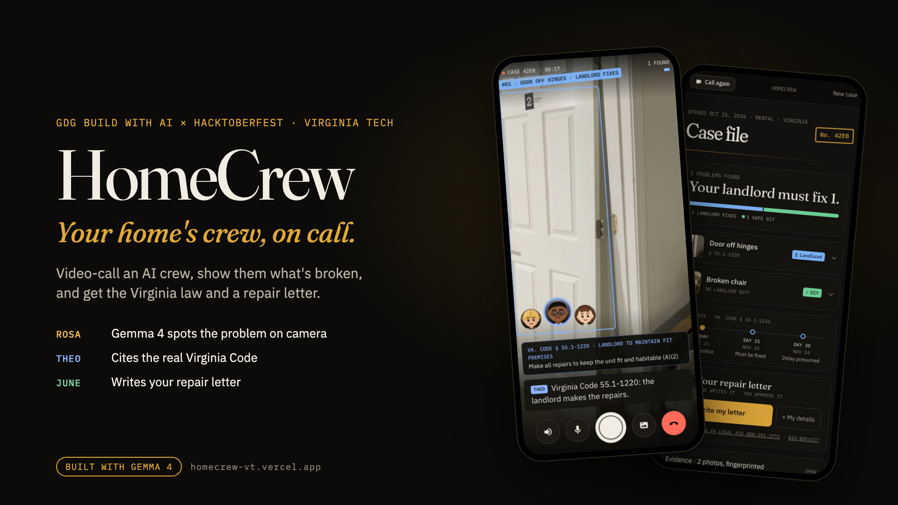
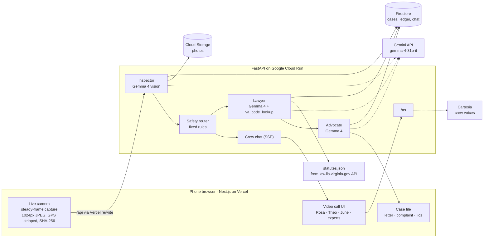

# HomeCrew



**Video-call a crew about what's wrong with your home. Gemma 4 sees the problem, a fixed set of safety rules decides who has to fix it, and for renters the crew cites the Virginia law and writes the repair letter. Free.**

Built at **GDG Build with AI x Hacktoberfest 2026**, Virginia Tech (Oct 24–25, 2026).
Tracks: GDG Best Overall · MLH **Best Use of Gemma 4**.

- **Live app:** https://homecrew-vt.vercel.app (open it on your phone; it uses the camera)
- **2-minute demo video:** https://youtu.be/VmhPm4puuAQ

---

## The problem

- Virginia has had **705,120 eviction filings** since March 2020, and **10,712 in September 2026** alone. [1]
- In 2024, **74.6% of landlords had a lawyer. 0.8% of tenants did.** [1] Tenants with a lawyer are **7x more likely to win**. [2]
- Since **July 1, 2026** (SB 373, Va. Code **§ 55.1-1241**), a tenant sued for unpaid rent can raise serious repair problems as a defense **without first paying rent into court**. [3] But the tenant still has to show the condition existed and that the landlord got **written notice**.

Most renters don't know which law applies, what notice to send, or how to document a problem so it holds up. HomeCrew does that part, on a phone, in a few minutes.

## What it does

**1. Video-call the crew.** Open the site, tap *Start a video call*, and point your camera around. Three characters are on the call, each with their own voice:

| | Who | What they do |
|---|---|---|
| 🟡 | **Rosa**, inspector | Gemma 4 looks at the camera feed. When the picture is steady she names the problem and a box is drawn on it ("#01 · DOOR OFF HINGES · LANDLORD FIXES") |
| 🔵 | **Theo**, lawyer | Names the Virginia rule in one line ("Virginia Code 55.1-1220: the landlord makes the repairs") while the citation shows as a card |
| 🟢 | **June**, advocate | Adds it to your repair letter ("They get 21 days") |

**2. Every finding gets a safety rating from fixed rules, not the AI** ([`api/app/safety.py`](api/app/safety.py)):

| | Tier | What happens |
|---|---|---|
| 🔴 | **Emergency** | Gas smell, CO alarm, sparks, active flooding: a full-screen "leave now / call 911" card, decided by rule before Gemma is even asked |
| 🟠 | **Call a licensed pro** | Wiring, panels, gas, water heaters, large mold, lead/asbestos, structural: the crew won't give step-by-step instructions |
| 🔵 | **Landlord must fix** (renters) | Theo cites the statute, June puts it in the notice |
| 🟢 | **Fix it yourself** | Spoken how-to from a fixed list ("Pull the stopper and clear the gunk, then plunge it…"). Your own furniture is always yours to fix, never the landlord's |

**3. Hang up and get a case file.** Who has to fix what, the exact Virginia law for each item (verbatim quote, checked against the statute), what to do in the meantime, and the § 55.1-1234 **21-day clock**. One tap drafts the **repair notice letter**, a **code-complaint packet** for the town inspector and a **calendar file** of deadlines. **Nothing exports until you approve it**, and HomeCrew never contacts anyone for you.

**Also:**
- **Describe a problem instead** ("my sink won't drain") and the right expert picks up: plumber, electrician, heating & AC, pests, locks & doors, or mold & water.
- **Own your home?** Flip *I RENT → I OWN*: same crew, no landlord letter, just what's safe to do and when to call a pro.
- **Ask out loud:** tap the mic and ask a question; emergencies and never-DIY topics are answered by rule before Gemma.
- **Evidence ledger:** every photo is SHA-256 hashed on the phone and re-hashed on the server, timestamped, and chained, so you can show later it wasn't altered.

## How Gemma 4 is used

All AI runs on **Gemma 4 (`gemma-4-31b-it`) through the Gemini API**, with `gemma-4-26b-a4b-it` as a fallback and local **Ollama `gemma4:e4b`** as an offline option. Thinking is set to minimal: on a live call a photo has to come back in about 5 seconds ([docs/inspector-eval.md](docs/inspector-eval.md)).

| Agent | Gemma 4 input | Output | Why it needs AI |
|---|---|---|---|
| Inspector (Rosa and the trade experts) | a camera frame + the expert's focus | JSON: problem type, box on the image, severity, confidence, one spoken line | Telling mold from a shadow, or a split door from a scuff, needs vision |
| Lawyer (Theo) | the findings + statute text it looks up with `va_code_lookup` | section, plain-English explanation, verbatim quote, defense flag | Maps messy real defects onto the right legal duty, grounded only in retrieved statute text |
| Advocate (June) | findings + the legal review | repair notice, complaint packet | Writes a specific letter for this case instead of a blank template |
| Ask | your question + the case so far | a short spoken answer | Free-form questions |

What Gemma is **not** trusted with is done in code: safety tiers, emergencies, deadlines, disclaimers, and the lines Theo and June say on the call (built from the findings and cached statute subsections, never generated). Prompts: [`api/app/prompts/`](api/app/prompts/).

## Architecture



**Google Cloud**

| Service | Role | Why |
|---|---|---|
| Cloud Run | FastAPI backend and all agents | Scales on demand; `max-instances=3` caps cost |
| Firestore | One document per case: findings, hash-chained ledger, crew chat | Every change is a transaction, so instances can't overwrite each other; TTL deletes cases after 30 days |
| Cloud Storage | Evidence photos | Private bucket, lifecycle rule deletes photos after 30 days |
| Secret Manager | Gemini and Cartesia keys | Keys never sit in code or plain env vars |
| IAM | Dedicated `homecrew-api` service account | Least privilege: Firestore, one bucket, its two secrets |

The web app proxies `/api/*` to Cloud Run, so the phone talks to one HTTPS origin (needed for the camera) and there's no CORS. During a call the browser streams the crew chat over SSE and, as a belt-and-braces, re-reads the case every 2 s, because some phone networks hold SSE back.

## Responsible AI

- **Grounded law:** Theo can only cite sections his lookup tool returned (from the official Virginia Legislative Information System API, cached in [`api/data/statutes.json`](api/data/statutes.json)). Quotes must match the statute word for word or are replaced with the closest real sentence. Deadlines and disclaimers come from code. Every legal output says *"Informational, not legal advice"* and points to free legal aid.
- **No invented problems:** the Inspector reports only what's visible; low-confidence findings are flagged for a human check. Rules the model doesn't always follow are enforced in code (e.g. a hole with no sign of water is never treated as a leak).
- **Safety first:** emergencies and never-DIY topics are handled by fixed rules before any model call, for both what the camera sees and what you ask.
- **Human in the loop:** nothing is drafted into a file, exported or sent without your Approve tap.
- **Abuse limits:** per visitor per 10 minutes: 120 photo analyses, 60 questions, 20 legal reviews, 20 letters, 30 new cases, 300 voice lines; plus 1,200 Gemma calls an hour per server. Logs store a one-way fingerprint, never raw IPs.
- **Privacy:** no accounts; name and address are optional; photos are downscaled and stripped of GPS/EXIF on the phone; everything auto-deletes after 30 days.
- **Accessibility:** every control is keyboard-reachable and labeled for screen readers, evidence photos have alt text, captions show every spoken line, and the color palette was chosen for WCAG AA contrast.

## Setup

Prereqs: Node 20+, pnpm, Python 3.12+, [uv](https://docs.astral.sh/uv/), a free [Google AI Studio key](https://aistudio.google.com/apikey). A [Cartesia](https://cartesia.ai) key is optional (without it the crew uses the browser's voice, then captions).

```bash
git clone https://github.com/mayankgoel214/homecrew && cd homecrew
cp api/.env.example api/.env        # add GEMINI_API_KEY (and CARTESIA_API_KEY)
cd api && uv sync && uv run uvicorn app.main:app --reload --port 8000
cd ../web && pnpm install && pnpm dev   # http://localhost:3000
```

Tests: `cd api && uv run pytest -q` · `cd web && npx tsc --noEmit && pnpm lint`.

**Phone camera locally:** the camera needs HTTPS. Run `ngrok http 3000` and open the printed URL on your phone (ngrok passes the live chat stream through; Cloudflare quick tunnels hold it back).

## Deploy

[docs/deploy.md](docs/deploy.md) has the exact commands (Cloud Run, Firestore, Cloud Storage, Secret Manager, then Vercel).

## API dependencies

| Service | Used for | Cost |
|---|---|---|
| Gemini API (Gemma 4) | inspector, lawyer, advocate, questions | free tier |
| law.lis.virginia.gov JSON API | statute text, cached ahead of time so a demo never depends on it | free, public |
| Cartesia (sonic-3) | the crew's voices | optional |
| Google Cloud Run, Firestore, Cloud Storage | backend, cases, photos | free tier |
| Vercel | frontend hosting with HTTPS | free tier |

A typical call uses one Gemma call per captured frame (about one every 5 seconds while the camera is steady on something new), then one for the legal review and one for the letter.

## Validation

We showed HomeCrew to our roommates, who rent in Blacksburg. All of them had run into the same problem: when they moved in there was no proper inspection, so later they had no record of what was already broken and no idea whose job a repair was. Their reaction was that a move-in walkthrough with a record and the law attached is genuinely needed. That pushed us toward the parts we built last: one call that covers the whole place, a case file that says plainly who fixes what, and a letter ready to send.

## Repo map

| Path | What's there |
|---|---|
| `web/src/components/HomeCrewApp.tsx` | The app shell: front page → call → case file |
| `web/src/components/call/` | Front page (lobby), the video call screen, emergency card |
| `web/src/components/report/` | Case file and the letter/approve flow |
| `web/src/components/` | Crew characters and badges, evidence ledger, transcript, shared UI |
| `web/src/hooks/` | Crew chat stream and turn-by-turn voice playback |
| `web/src/lib/` | API client, crew voices, steady-frame capture, speech recognition, safety mirror |
| `api/app/main.py` | All endpoints |
| `api/app/agents/` | Inspector, Lawyer, Advocate |
| `api/app/crew.py` | What the crew says on the call (built from facts, not generated) |
| `api/app/safety.py` | The tier rules, emergencies, never-DIY list, fix-it-yourself steps |
| `api/app/store.py` | Cases, hash-chained ledger; local disk or Firestore + Cloud Storage |
| `scripts/record-demo/` | How the demo video was made: plays footage into the real app as the camera, records the screen, edits the cut |
| `docs/` | Design notes, research, deploy, evaluation |

## Sources

1. Legal Services Corporation, Civil Court Data Initiative, Virginia eviction data, https://civilcourtdata.lsc.gov/data/eviction/virginia (accessed Oct 24, 2026)
2. LSC, Virginia eviction & debt report 2018–2023, https://civilcourtdata.lsc.gov/research/reports/va-2023-eviction-and-debt
3. Va. Code § 55.1-1241 (as amended by 2026 Acts, c. 959 / SB 373), https://law.lis.virginia.gov/vacode/55.1-1241/

## Built with

Gemma 4 · Gemini API · Next.js 15 · Tailwind · FastAPI · Google Cloud Run · Firestore · Cloud Storage · Secret Manager · Cartesia · Vercel.
**AI coding tools used:** Claude Code. Per MLH rules, we disclose AI-assisted development.

## Team

- Mayank Goel · [@mayankgoel214](https://github.com/mayankgoel214)
- Mali · [@malip23](https://github.com/malip23)
- Cinthia · [@ferchitp](https://github.com/ferchitp)

## License

[MIT](LICENSE)
